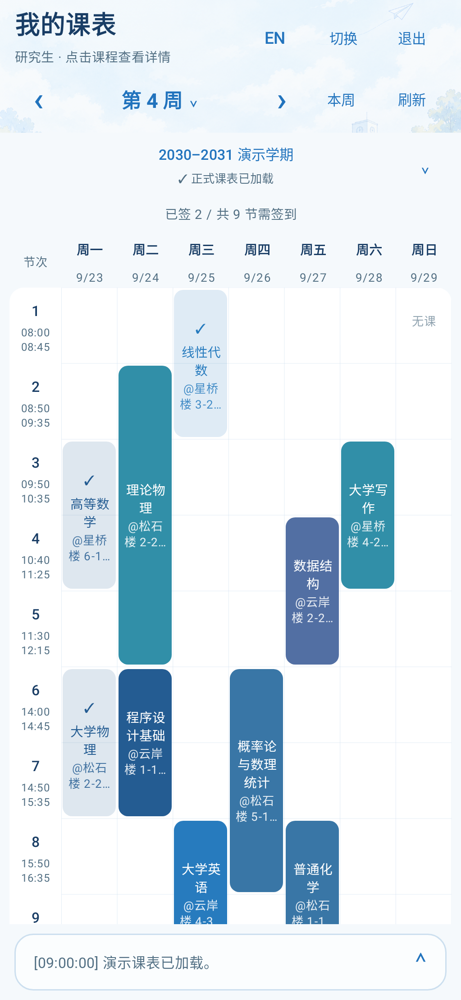
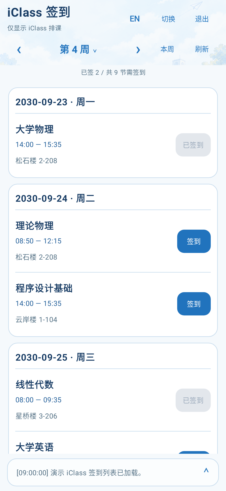
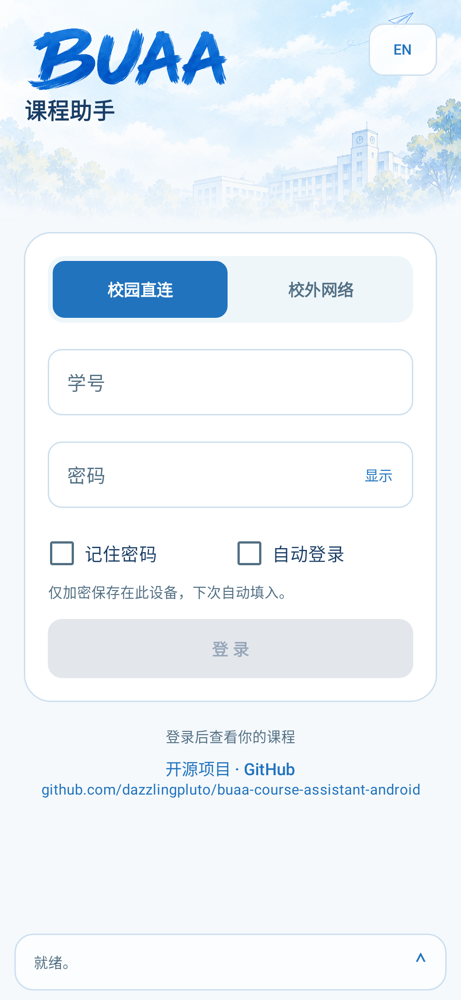
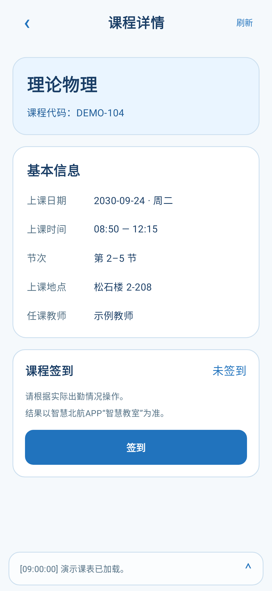

# BUAA Course Assistant · 北航课程助手

面向 Android 手机的北航课程助手，支持查看本科生和研究生的教务周课表，以及通过课表或 iClass 列表手动签到。

## 安装与更新

1. 在 Android 7.0 或更高版本的手机上，打开 [最新发布页](https://github.com/dazzlingpluto/buaa-course-assistant-android/releases/latest)。
2. 在发布页的 **Assets** 中下载 APK。下载完成后打开 APK，按系统提示安装。
3. 安装后打开「北航课程助手」。已有版本使用相同签名时，可以直接覆盖安装并保留应用数据。

更新应用时，从 [GitHub Releases](https://github.com/dazzlingpluto/buaa-course-assistant-android/releases/latest) 下载 APK 并覆盖安装。

## 使用

1. **选择网络并登录**。使用校园 Wi-Fi 时选「校园直连」，使用移动数据或校外 Wi-Fi 时选「校外网络」。输入北航统一身份认证学号和密码。若出现图片验证码，输入后继续登录，点击图片可换一张。
2. **查看课表**。应用会自动识别本科生或研究生的课表入口。登录后可以选择学期、切换周次，点「本周」返回当前周。点击课程卡片查看时间、地点和签到状态。
3. **手动签到**。进入课程详情，在对应的 iClass 场次点「签到」。同一门课有多个场次时，分别操作并查看进度。显示「✓ 无需签到」时，该课程本周无关联的 iClass 排课。若签到暂不可用，可点「刷新」重试。签到结果可在智慧北航 App 的「智慧教室」核对。
4. **切换签到模式**。默认使用课表签到。点右上角「切换」可直接读取 iClass 签到列表，正式课表加载失败时也能使用。再次点击即可返回课表签到。

## 记住密码与自动登录

两个选项默认关闭。开启「记住密码」后，应用会在成功登录后将凭据加密保存在手机上。开启「自动登录」会同时开启「记住密码」。自动登录遇到验证码时，需要手动输入后继续。

退出登录会关闭自动登录。取消勾选「记住密码」可删除已保存的凭据。

## 界面预览

以下截图使用演示数据。

| 课表签到 | iClass 签到 |
| --- | --- |
|  |  |

| 登录页 | 课程详情 |
| --- | --- |
|  |  |

## 免责声明

- 本项目为非官方课程辅助工具，与北京航空航天大学官方无关联。请遵循学校相关规章制度，合理使用，避免恶意并发或破坏系统稳定性的操作。
- 请用户遵守 BUAA 相关规章与制度，请仅使用本人有权使用的账号，在账号授权范围内访问课程信息，并遵守适用法律法规、学校规章制度及相关服务的使用规则。
- 签到功能应依据实际出勤情况使用，不得用于代签、虚假签到、冒用身份、绕过访问限制或干扰学校系统运行。违反上述要求所产生的责任，由相关责任主体依法承担。

## 许可证

本项目中维护者有权许可的代码采用 GNU General Public License v3.0 only（GPL-3.0-only）授权，完整条款见 [LICENSE](LICENSE)。第三方代码、依赖及素材适用各自的许可条款。上述使用说明独立于 GPL 授权条款。
